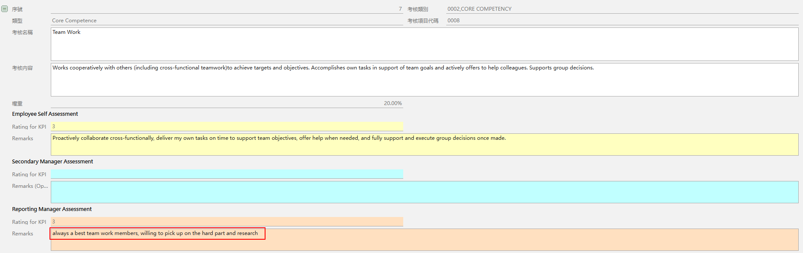
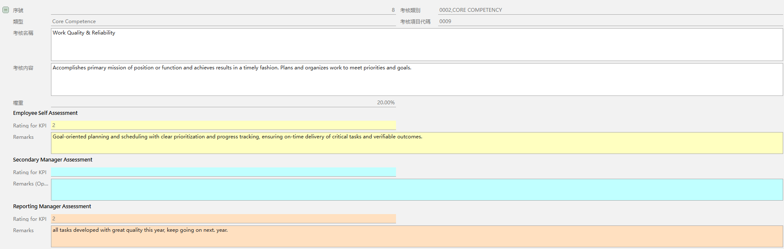
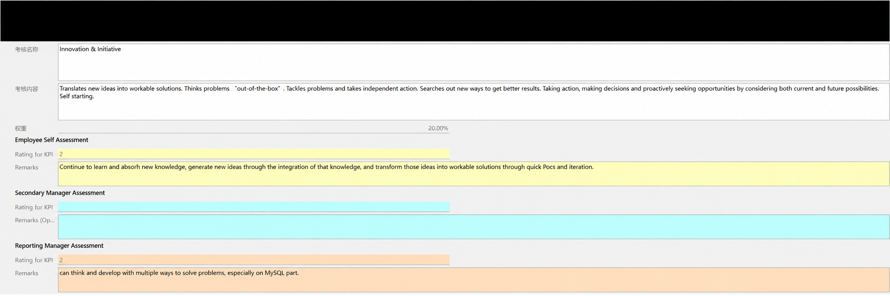
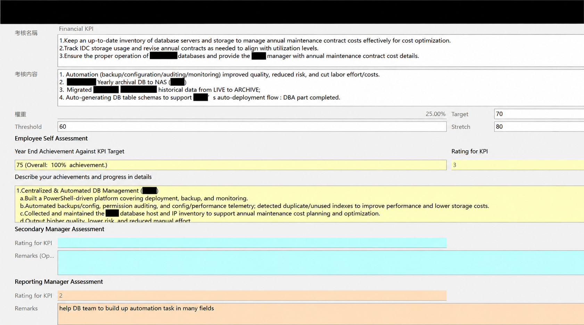
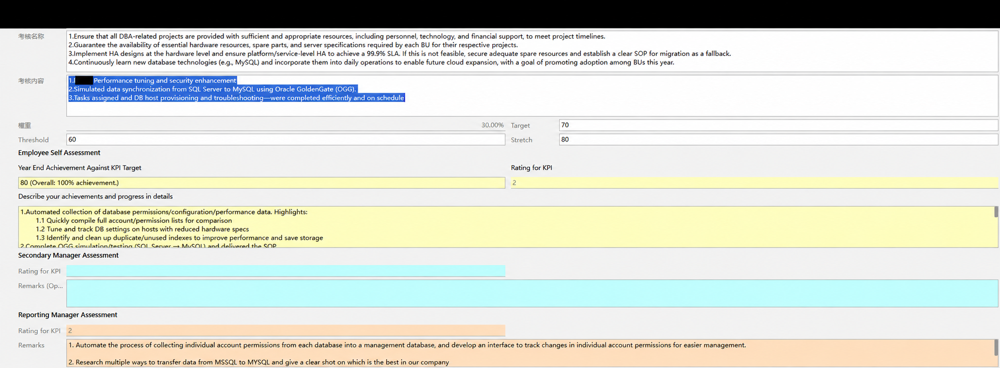
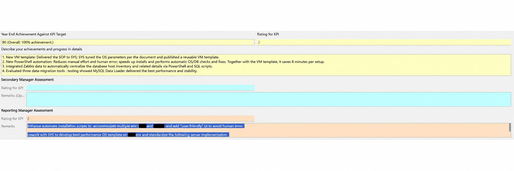

# 2025 年度考績與工作成果

擔任 DBA，年度考績為全團隊最佳（依本人提供資訊）。主要成果是把重複的維運工作自動化、提升建置效率，並研究資料庫移轉方式。

> 年度依「去年」推定為 2025 年。圖片已遮蔽內部代稱與組織資訊，部分經影像編輯，非未修改原件。

## 主要成果

- **減少人工操作：** 使用 PowerShell 自動處理部署、備份、監控及權限檢查。
- **加快主機建置：** 與系統團隊建立 VM 範本，搭配自動安裝與檢查，每次建置節省約 **8 分鐘**。
- **集中管理資訊：** 整合主機清單、監控、設定及效能資料，方便追蹤與管理。
- **改善效能與空間使用：** 清理重複或未使用的索引，調整資料庫設定，並封存歷史資料。
- **完成移轉測試：** 使用 Oracle GoldenGate 測試 SQL Server 到 MySQL 的資料同步，交付操作文件，並比較三種資料移轉工具。

## 主管評價與考績截圖

### 1. 團隊合作

願意承擔困難工作，也願意投入研究。自評與主管評分均為 3。

### 2. 工作品質

主管肯定當年度各項工作的品質。自評與主管評分均為 2。

### 3. 創新與主動性

能提出多種解決問題的方法，尤其在 MySQL 領域。自評與主管評分均為 2。

### 4. 自動化與成本管理

協助團隊建立多種自動化作業，減少人工負擔，支援效能及儲存空間改善。自評為 3，主管評分為 2。

### 5. 資料庫服務與資料移轉

自動整理帳號權限與效能資料，完成 SQL Server 到 MySQL 的同步測試及操作文件。自評與主管評分均為 2。

### 6. 建置標準化與工具評估

建立 VM 範本與 PowerShell 自動化流程，每次建置節省約 8 分鐘，並完成三種資料移轉工具的比較。自評與主管評分均為 2。

